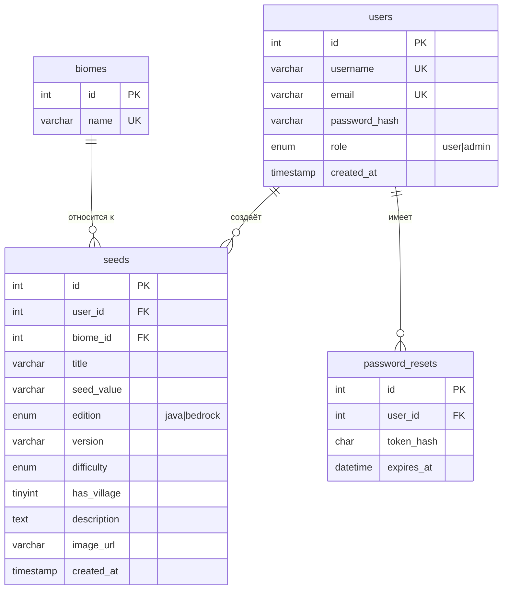

# SeedVault: каталог сидов Minecraft


## Содержание

1. [Теоретическая часть](#1-теоретическая-часть)
2. [Практическая часть](#2-практическая-часть)
3. [Запуск проекта](#3-запуск-проекта)
4. [Функциональные возможности](#4-функциональные-возможности)
5. [Сценарии взаимодействия](#5-сценарии-взаимодействия)
6. [Структура базы данных](#6-структура-базы-данных)
7. [Безопасность](#7-безопасность)
8. [Примеры использования](#8-примеры-использования)
9. [Выводы](#9-выводы)


---

## 1. Теоретическая часть

### 1.1. Формулировка задачи

Разработать веб-приложение средней сложности с функционалом на стороне сервера: регистрация и вход, общедоступный раздел с данными из БД, две формы (создание ресурса с 5+ полями и поиск), защищённый раздел с ролью «администратор», безопасное хранение паролей, модульная архитектура, документация PHPDoc.

### 1.2. Тема

Minecraft-игроки часто ищут «сиды» (seed): числовые значения, по которым игра генерирует один и тот же мир. Хорошие сиды разбросаны по форумам и видео. **SeedVault** собирает их в одном каталоге: каждый сид описывается версией, редакцией, биомом, сложностью, наличием деревни у спавна и описанием. Пользователи добавляют сиды и ищут их по фильтрам.

### 1.3. Цель и основные этапы

**Цель:** создать на PHP и MySQL защищённое веб-приложение по архитектуре MVC.

Этапы:
1. Проектирование предметной области и схемы БД.
2. Реализация ядра: подключение к БД, маршрутизация, сессии, CSRF-защита.
3. Регистрация, вход, хеширование паролей.
4. Публичная главная страница с данными из БД.
5. Форма создания сида (8 полей) с клиентской и серверной валидацией.
6. Форма поиска с фильтрами и пагинацией.
7. Панель администратора.
8. Восстановление пароля по email (дополнительное задание).
9. Документация, тестирование, подготовка к защите.

### 1.4. Используемые технологии

| Технология | Назначение |
|---|---|
| PHP 8.1+ | серверная логика |
| MySQL / MariaDB + PDO | хранение данных, подготовленные запросы |
| Bootstrap 5 (CDN) | адаптивная вёрстка |
| JavaScript (Constraint Validation API) | клиентская валидация |
| PHPMailer (Composer) | отправка писем для восстановления пароля |

### 1.5. Архитектура MVC

- **Model** (`app/Models`): работа с таблицами через PDO (`User`, `Seed`, `Biome`, `PasswordReset`).
- **View** (`app/Views`): HTML-шаблоны с экранированием вывода.
- **Controller** (`app/Controllers`): обработка запросов, валидация, вызов моделей.
- **Core** (`app/Core`): инфраструктура: `Router`, `Database`, `Auth`, `Csrf`, `Flash`, `View`, `Mailer`, `Env`.
- **Front controller** `public/index.php`: единственная точка входа, в веб-корне находится только папка `public/`.

---

## 2. Практическая часть

### 2.1. Структура проекта

```
seedvault/
├── public/              веб-корень: index.php, assets/ (css, js)
├── app/
│   ├── Core/            Router, Database, Auth, Csrf, Flash, View, Mailer, Env
│   ├── Controllers/     Home, Auth, Seed, Admin
│   ├── Models/          User, Seed, Biome, PasswordReset
│   └── Views/           layout, auth, seeds, admin
├── database/schema.sql  схема БД
├── bin/install.php      установщик (БД, админ, демо-данные)
├── storage/             mail.log (письма при отсутствии SMTP)
├── .env.example         шаблон настроек
└── composer.json
```

### 2.2. Особенности реализации

- **Собственный маршрутизатор** с параметрами (`/seeds/{id}/edit`), 404 для неизвестных путей.
- **Автозагрузка PSR-4** работает и через Composer, и без него (резервный загрузчик в `index.php`), поэтому проект запускается даже до `composer install`.
- **Динамический SQL для поиска** собирается из условий, но все значения передаются через подготовленные запросы (`?`), а значения `ENUM`-фильтров дополнительно сверяются с белыми списками.
- **Пагинация**: 9 сидов на страницу, параметры фильтра сохраняются в ссылках.
- **Права на сиды**: изменять и удалять сид может автор или администратор (проверка на сервере в `SeedController::loadManageable`).
- **Выход из системы** выполняется POST-запросом с CSRF-токеном.
- **Если PHPMailer или SMTP недоступны**, письмо восстановления пароля записывается в `storage/mail.log`.

---

## 3. Запуск проекта

### 3.1. Требования

- PHP 8.1+ с расширениями `pdo_mysql`, `mbstring`, `openssl`
- MySQL 5.7+ или MariaDB 10.4+ (подойдёт XAMPP)
- Composer (необязательно, нужен только для PHPMailer)
- Git

### 3.2. Установка

```bash
git clone https://github.com/ваш_логин/seedvault.git
cd seedvault

# 1. Настройки
copy .env.example .env        # Linux/macOS: cp .env.example .env
# при необходимости отредактируйте DB_USER / DB_PASS в .env

# 2. (необязательно) библиотеки
composer install

# 3. База данных: создаёт БД, таблицы, администратора и демо-сиды
php bin/install.php

# 4. Запуск встроенного сервера
php -S localhost:8000 -t public
```

Откройте <http://localhost:8000>.

### 3.3. Учётные записи после установки

| Роль | Логин | Пароль |
|---|---|---|
| Администратор | `admin` | `Admin12345` |
| Пользователь | `steve` | `Steve12345` |

> Смените пароль администратора перед публикацией.

### 3.4. Проверка восстановления пароля

- **Без почтового сервера:** оставьте `MAIL_HOST=` пустым, письмо с ссылкой появится в `storage/mail.log`.
- **С Mailpit:** запустите Mailpit (SMTP на порту 1025, веб-интерфейс на <http://localhost:8025>) и оставьте `MAIL_HOST=127.0.0.1`, `MAIL_PORT=1025`. Нужен `composer install`.
- **С Gmail:** `MAIL_HOST=smtp.gmail.com`, `MAIL_PORT=587`, `MAIL_USER` и `MAIL_PASS` (пароль приложения).

---

## 4. Функциональные возможности

| Компонент | Реализация |
|---|---|
| Регистрация и вход | `/register`, `/login`, пароли через `password_hash()` (bcrypt), проверка `password_verify()` |
| Восстановление пароля (доп.) | `/forgot` → письмо со ссылкой `/reset?token=...`, токен одноразовый, живёт 1 час, в БД хранится его SHA-256 хеш |
| **Общедоступный раздел** | Главная `/`: последние сиды, популярные биомы, лучшие авторы, счётчики (4 динамических блока из БД); каталог `/seeds`; страница сида `/seeds/{id}` |
| **Форма создания ресурса** | `/seeds/create`: 8 полей (text, number-text, radio, 3 × select, checkbox/switch, textarea, url), валидация на клиенте и сервере |
| **Форма поиска** | `/seeds`: ключевое слово, редакция, версия, биом, сложность, «есть деревня» |
| Личный кабинет | `/my`: свои сиды, правка и удаление |
| **Роль администратора** | см. ниже |

### Функции администратора (5)

1. **Статистика** (`/admin`): число пользователей и сидов, сиды по биомам, топ авторов (`GROUP BY`).
2. **Управление пользователями** (`/admin/users`): просмотр, смена роли, удаление (себя изменить нельзя).
3. **Создание новых администраторов** (`/admin/admins/create`).
4. **Управление сидами** (`/admin/seeds`): просмотр всех, редактирование, удаление.
5. **Справочник биомов** (`/admin/biomes`): добавление, переименование, удаление (запрещено, пока биом используется).

### Валидация формы «Добавить сид»

| Поле | Тип | Правило |
|---|---|---|
| title | text | 3-100 символов |
| seed_value | text | целое число, возможен минус, до 19 цифр |
| edition | radio | `java` или `bedrock` |
| version | select | из списка допустимых версий |
| biome_id | select | существующий биом из БД |
| difficulty | select | `peaceful`/`easy`/`normal`/`hard` |
| has_village | checkbox | 0 или 1 |
| description | textarea | 10-2000 символов |
| image_url | url | необязательно, только `http://` или `https://` |

Клиент: HTML5-атрибуты (`required`, `pattern`, `minlength`) + `app.js` (подсветка, сообщения). Сервер: `SeedController::validate()`, ошибки возвращаются в форму рядом с полями, введённые данные сохраняются.

---

## 5. Сценарии взаимодействия

**Гость.** Открывает главную → видит последние сиды и статистику → переходит в «Поиск сидов» → выбирает фильтры → открывает карточку сида и копирует значение кнопкой. Попытка открыть `/seeds/create` или `/admin` перенаправляет на вход.

**Новый пользователь.** Регистрируется (ошибки подсказываются под полями) → входит → «Добавить сид» → заполняет форму → попадает на страницу сида → в «Мои сиды» может изменить или удалить свою запись. Чужой сид изменить нельзя (403).

**Забыл пароль.** «Забыли пароль?» → вводит email → получает письмо → переходит по ссылке → задаёт новый пароль → входит. Ссылка работает один раз и 1 час.

**Администратор.** Входит → «Админ-панель» → смотрит статистику → создаёт второго администратора → удаляет некорректный сид → добавляет новый биом → меняет роль пользователя.

---

## 6. Структура базы данных



- `seeds.user_id`: `ON DELETE CASCADE` (при удалении пользователя удаляются его сиды).
- `seeds.biome_id`: `ON DELETE RESTRICT` (нельзя удалить используемый биом).
- Индексы по `created_at`, `(edition, biome_id)` и `token_hash` ускоряют главную страницу, поиск и сброс пароля.

Полный скрипт: [`database/schema.sql`](database/schema.sql).

---

## 7. Безопасность

| Угроза | Защита | Где |
|---|---|---|
| Утечка паролей | `password_hash` / `password_verify`, пароли не хранятся в открытом виде | `User::create`, `AuthController::login` |
| SQL-инъекции | PDO, подготовленные запросы, `ATTR_EMULATE_PREPARES = false` | все модели |
| XSS | `htmlspecialchars` для всего пользовательского вывода (`e()`), валидация URL по схеме | `View::e`, шаблоны |
| CSRF | токен в сессии, `hash_equals`, проверка во всех POST | `Csrf` |
| Фиксация сессии | `session_regenerate_id(true)` при входе, cookie `HttpOnly` и `SameSite=Lax` | `Auth::login`, `index.php` |
| Обход авторизации | `requireLogin()`/`requireAdmin()` на сервере, проверка владельца записи | `Auth`, контроллеры |
| Подбор пароля | блокировка на 60 с после 5 неудачных попыток | `AuthController::login` |
| Перечисление email | одинаковый ответ в «Забыли пароль?» для любых адресов | `AuthController::forgot` |
| Кража токена сброса | в БД хранится только SHA-256, срок 1 час, одноразовый | `PasswordReset` |
| Clickjacking / MIME-sniffing | заголовки `X-Frame-Options`, `X-Content-Type-Options` | `index.php` |
| Раскрытие секретов | `.env` в `.gitignore`, в веб-корне только `public/` | |

---

## 8. Примеры использования

> Вставьте сюда скриншоты своего запущенного проекта (папка `docs/screenshots/`):
>
> - ``
> - ``
> - ``
> - ``
> - ``
> - ``

Фрагмент: хеширование и проверка пароля

```php
$hash = password_hash($password, PASSWORD_DEFAULT);       // при регистрации
if (password_verify($input, $user['password_hash'])) {    // при входе
    Auth::login($user);
}
```

Фрагмент: безопасный поиск (значения только через `?`)

```php
if (isset(self::EDITIONS[$f['edition'] ?? ''])) {
    $where .= ' AND s.edition = ?';
    $params[] = $f['edition'];
}
```

---

## 9. Выводы

В ходе работы создано веб-приложение SeedVault на PHP и MySQL с архитектурой MVC. Реализованы регистрация и вход с безопасным хранением паролей, восстановление пароля по email, публичный раздел с данными из БД, форма создания ресурса с 9 полями и двойной валидацией, форма поиска с фильтрами и пагинацией, а также панель администратора с 5 функциями. Приложение защищено от SQL-инъекций, XSS, CSRF и фиксации сессии. Код документирован в формате PHPDoc.

